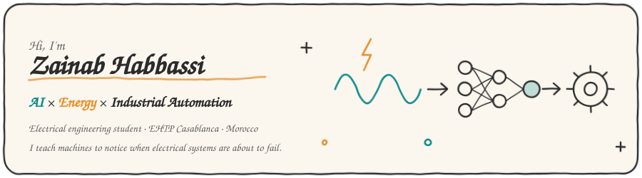
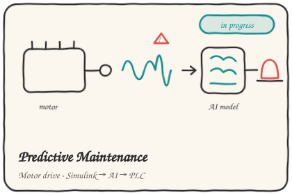
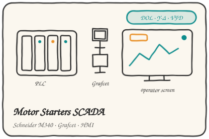
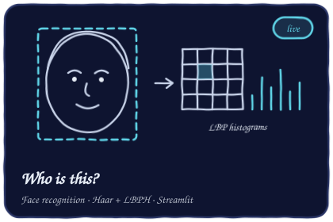
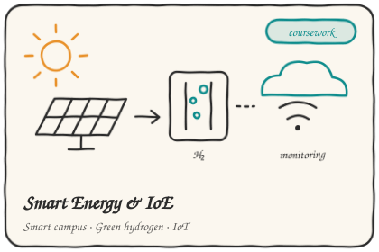

  

### 👋 About me

I'm a final-year **electrical engineering** student.
I like the moment where a power system, a PLC and a bit of machine learning start talking to each other.

- 🔧 **Right now:** building a predictive maintenance system for motor drives, from a Simulink model all the way to a PLC alarm
- 🌱 **Long-term:** AI for renewable energy and smarter industrial plants
- 🎯 **Looking for:** a final-year internship (PFE) in AI for energy or industrial automation

---

### 🗂️ Projects

<table>
  <tr>
    <td width="50%" valign="top">
      
      
Detecting motor drive faults (phase imbalance, overload, IGBT failure) from current signals, then sending the diagnosis back to a PLC. <i>Coming soon.</i>

    </td>
    <td width="50%" valign="top">
      
      
Control Expert project on a Schneider M340: DOL, reversing DOL, ATS, soft starter and VFD, each with its own Grafcet and an operator screen. <i>Coming soon.</i>

    </td>
  </tr>
  <tr>
    <td width="50%" valign="top">
      
      
Face recognition with classic computer vision (Haar Cascades + LBPH), wrapped in a Streamlit app with webcam support.

    </td>
    <td width="50%" valign="top">
      
      
IoE case studies: an energy-monitoring app for a self-sufficient campus and a smart green hydrogen plant. <i>Coming soon.</i>

    </td>
  </tr>
</table>

---

### 🧰 Toolbox

**AI & data** &nbsp;

**Simulation** &nbsp;

**Automation** &nbsp;
-3DCD58?logo=schneiderelectric&logoColor=white)

**Energy** &nbsp;

---

### 📫 Let's talk

Open to internship opportunities and to chatting about AI in energy.
<!-- TODO: replace with your real LinkedIn URL -->

<!-- Optional: add an email badge if you want it public -->
